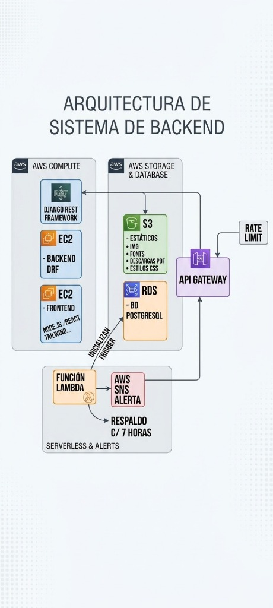
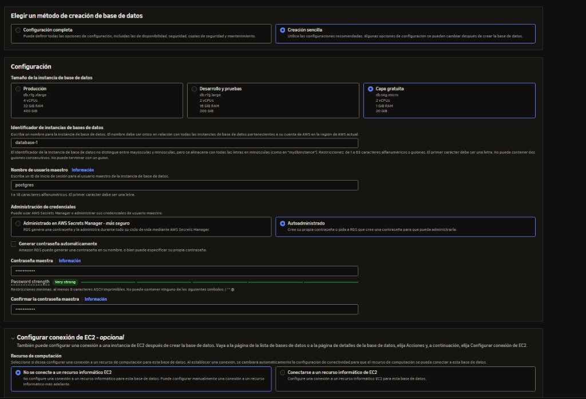
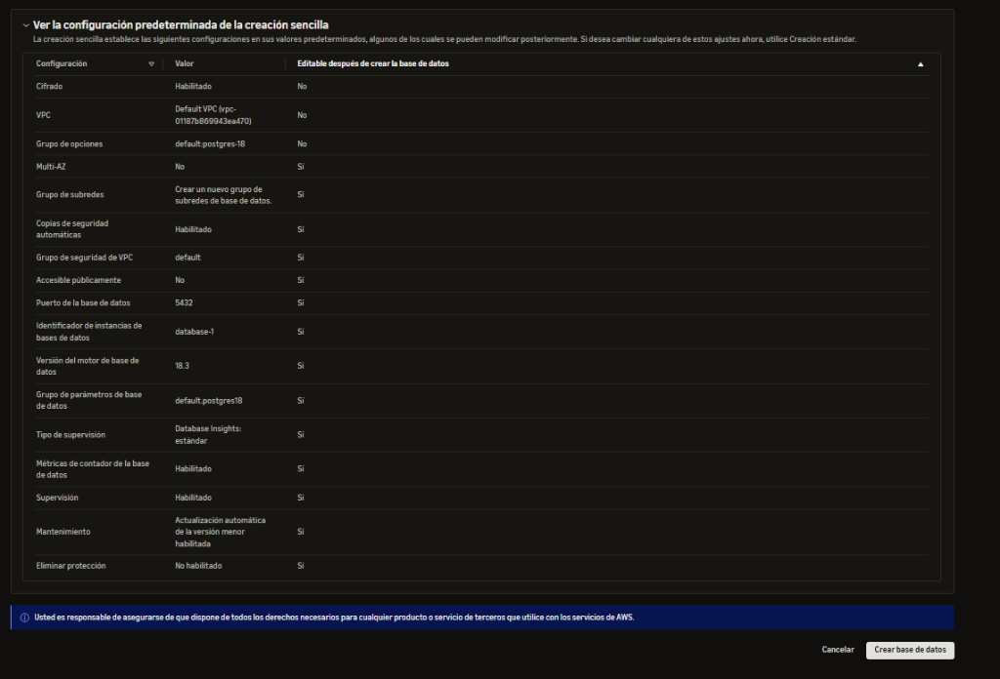
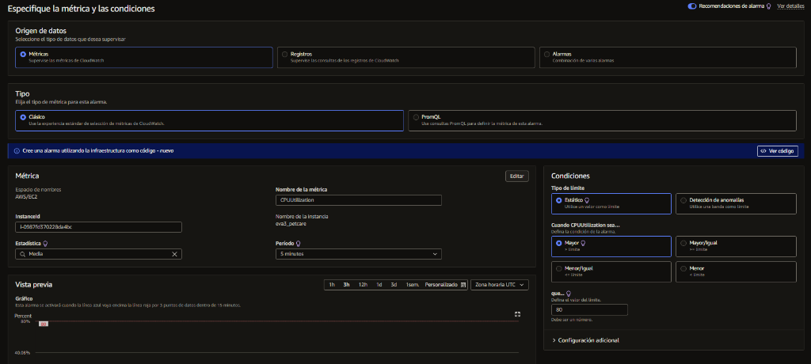
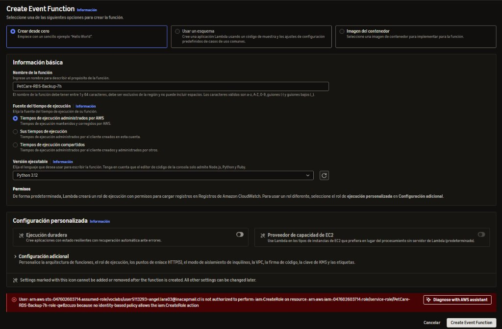
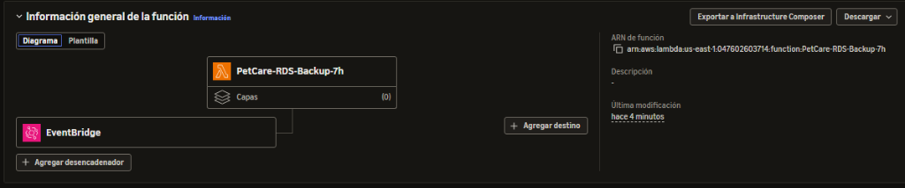
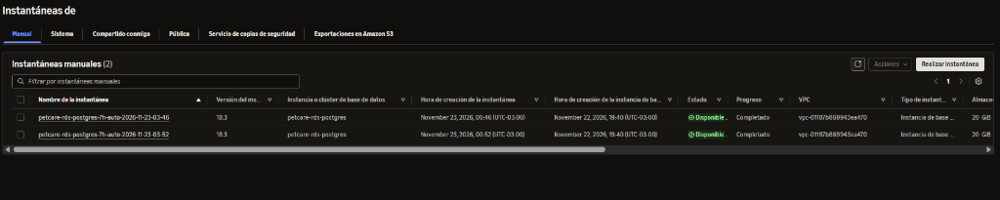
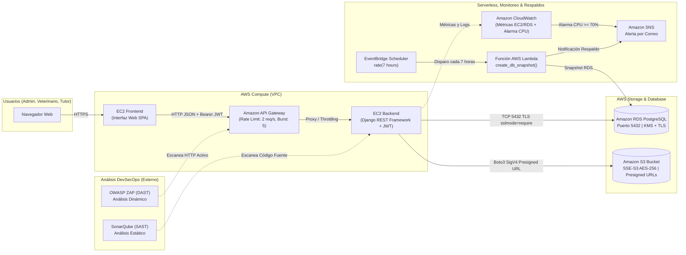

# INFORME TÉCNICO INTEGRAL — EVALUACIÓN N.º 4 (PROGRAMACIÓN BACKEND)
## Unidad 3: Aplicación API RESTful – Arquitectura AWS, Integración y Seguridad

- **Proyecto:** **PetCare** — Sistema Distribuido de Gestión de Citas, Fichas Clínicas y Vacunación Veterinaria
- **Estudiante:** Angel Eduardo Lara Manriquez (`Sección IEC-N4-C2`)
- **Docente:** Marcelo Alvarado Aravena
- **Institución:** INACAP — Año 2026
- **Repositorio GitHub EVA 4:** `https://github.com/Eduarts-00/eva4_backend_petcare.git`
- **URL EC2 Frontend Desacoplado (`eva4_petcare_FRONTEND`):** `http://3.230.130.63/`
- **URL Amazon API Gateway (`Rate Limit: 2 req/s, Burst: 5`):** `https://ozp0ipskkf.execute-api.us-east-1.amazonaws.com/prod`
- **URL EC2 Backend DRF (`eva3_petcare`):** `https://petcaree.duckdns.org/` (`98.85.49.169`)
- **Endpoint Amazon RDS PostgreSQL 18.3:** `petcare-rds-postgres.cdsudpkituru.us-east-1.rds.amazonaws.com:5432`
- **Bucket Amazon S3 (`SSE-S3` + `Block Public Access`):** `petcare-eva4-static-media-2026-047602603714-us-east-1-an`
- **ARN Función AWS Lambda (Respaldo cada 7h):** `arn:aws:lambda:us-east-1:047602603714:function:PetCare-RDS-Backup-7h`

---

## 0. Índice de Evidencias Numeradas (Capturas Reales de Infraestructura AWS)

| N.º | Evidencia / Criterio | Archivo en Repositorio |
| :--- | :--- | :--- |
| **Evidencia 01** | Diagrama de Arquitectura Distribuida AWS implementada | [`evidencias_aws/evidencia_01_arquitectura_aws.jpg`](./evidencias_aws/evidencia_01_arquitectura_aws.jpg) |
| **Evidencia 02** | Creación de instancia Amazon RDS PostgreSQL (`db.t4g.micro`) | [`evidencias_aws/evidencia_02_rds_creacion.jpg`](./evidencias_aws/evidencia_02_rds_creacion.jpg) |
| **Evidencia 03** | Verificación de Cifrado KMS, Puerto `5432` y Respaldos Automáticos en RDS | [`evidencias_aws/evidencia_03_rds_cifrado_kms_y_backups.png`](./evidencias_aws/evidencia_03_rds_cifrado_kms_y_backups.png) |
| **Evidencia 08** | Configuración de Alarma `CPUUtilization` en Amazon CloudWatch (`i-0987fd370228da4bc`) | [`evidencias_aws/evidencia_08_cloudwatch_alarma_cpu.png`](./evidencias_aws/evidencia_08_cloudwatch_alarma_cpu.png) |
| **Evidencia 09** | Creación de Función AWS Lambda `PetCare-RDS-Backup-7h` (Python 3.12 + `LabRole`) | [`evidencias_aws/evidencia_09_lambda_config_iam.jpg`](./evidencias_aws/evidencia_09_lambda_config_iam.jpg) |
| **Evidencia 10** | Diagrama de Función AWS Lambda conectada a Amazon EventBridge (`rate(7 hours)`) | [`evidencias_aws/evidencia_10_lambda_eventbridge_7h.png`](./evidencias_aws/evidencia_10_lambda_eventbridge_7h.png) |
| **Evidencia 11** | Snapshots de RDS PostgreSQL 18.3 creados por la Lambda cada 7h (`Disponibles`) | [`evidencias_aws/evidencia_11_rds_snapshots_7h_disponibles.png`](./evidencias_aws/evidencia_11_rds_snapshots_7h_disponibles.png) |

### Galería Visual de Evidencias AWS

#### Evidencia 01 — Arquitectura Distribuida AWS


#### Evidencia 02 y 03 — Amazon RDS PostgreSQL 18.3 (Cifrado KMS, Puerto 5432 y Respaldos Automáticos)



#### Evidencia 08 — Alarma de Monitoreo en Amazon CloudWatch (`CPUUtilization`)


#### Evidencia 09, 10 y 11 — Automatización Serverless de Respaldos cada 7 Horas (`EventBridge` + `AWS Lambda` + Snapshots RDS Disponibles)




---

## 1. Arquitectura Distribuida en AWS (Sección 3)

La arquitectura de **PetCare EVA 4** separa explícitamente las capas de **presentación (EC2 Frontend)**, **control de tráfico API (Amazon API Gateway)**, **procesamiento de negocio (EC2 Backend Django REST Framework)**, **persistencia relacional (Amazon RDS PostgreSQL)**, **almacenamiento de objetos y estáticos (Amazon S3)** y **observabilidad/recuperación (Amazon CloudWatch + Amazon SNS + EventBridge + AWS Lambda)**.



---

## 2. Actividad 1 — Desarrollo e Integración de la API RESTful (DRF + PostgreSQL + JWT)

### 2.1 Entidades Relacionadas en PostgreSQL (7 Modelos)
1. **`CustomUser` (`users.models`):** Extiende `AbstractUser` con RBAC (`ADMIN`, `VETERINARIO`, `TUTOR`), `rut`, `telefono` y control de cambio obligatorio de contraseña temporal (`debe_cambiar_password`).
2. **`Profesional` (`clinica.models`):** Médico Veterinario vinculado 1:1 con `CustomUser`, especialidad, jornada horaria (`hora_inicio_jornada`, `hora_fin_jornada`) y duración de bloque (`duracion_bloque_min`).
3. **`Tutor` (`clinica.models`):** Propietario responsable de pacientes veterinarios (`rut` único, datos de contacto y relación 1:N con `Mascota`).
4. **`Mascota` (`clinica.models`):** Paciente clínico vinculado mediante `ForeignKey` a `Tutor`, con especie, raza, sexo, peso en kg, microchip y estado de esterilización.
5. **`CitaMedica` (`clinica.models`):** Agenda médica que relaciona `Mascota` y `Profesional` con validación transaccional atómica anti-solapamiento de horarios en `clean()` y `perform_create()`.
6. **`FichaClinica` (`clinica.models`):** Registro clínico inmutable (anamnesis, diagnóstico, tratamiento, receta médica y exámenes) que al guardarse actualiza automáticamente el peso de la mascota y marca la cita como `ATENDIDA`.
7. **`ControlVacuna` (`clinica.models`):** Seguimiento de vacunas, desparasitaciones y controles periódicos con cálculo dinámico de semáforo (`VENCIDO`, `PROXIMO`, `AL_DIA`, `COMPLETADO`).

### 2.2 Catálogo de Endpoints CRUD, Validaciones y Códigos HTTP

| Método HTTP | Endpoint REST | Operación / Alcance RBAC | Códigos de Respuesta |
| :--- | :--- | :--- | :--- |
| `POST` | `/api/auth/login/` | Autenticación híbrida: retorna tokens JWT (`access`, `refresh`) + perfil con rol | `200 OK`, `401 Unauthorized`, `403 Forbidden` |
| `POST` | `/api/auth/refresh/` | Renovación de Access Token JWT | `200 OK`, `401 Unauthorized` |
| `GET` | `/api/auth/verificar-hash/` | Evidencia criptográfica en vivo de `PBKDF2-HMAC-SHA256` y `Salt` único | `200 OK` |
| `GET/POST/PUT/DELETE` | `/api/profesionales/` | CRUD de médicos veterinarios, bloqueo de cuentas y bloques disponibles | `200`, `201`, `204`, `400`, `403` |
| `GET/POST/PUT/DELETE` | `/api/tutores/` | CRUD completo de Tutores con listado anidado de sus mascotas | `200`, `201`, `204`, `400`, `403` |
| `GET/POST/PUT/DELETE` | `/api/mascotas/` | CRUD completo de Mascotas con filtros por especie, sexo y búsqueda por RUT/chip | `200`, `201`, `204`, `400`, `403` |
| `GET/POST/PUT/PATCH/DELETE` | `/api/citas/` | CRUD de Citas Médicas con bloqueo automático de cruces de horario | `200`, `201`, `204`, `400 Bad Request` |
| `GET/POST/PUT/DELETE` | `/api/fichas-clinicas/` | Emisión y consulta de Fichas Clínicas Digitales | `200`, `201`, `204`, `400`, `403` |
| `GET/POST/PUT/DELETE` | `/api/recordatorios/` | CRUD de Vacunación y Controles Periódicos + `/alertas/` | `200`, `201`, `204`, `400`, `403` |
| `GET` | `/api/aws/estado/` | Estado en vivo de RDS PostgreSQL, Amazon S3, API Gateway y CloudWatch | `200 OK` |
| `GET` | `/api/aws/s3-presigned-url/` | Generación de URL Prefirmada AWS S3 (`AWS4-HMAC-SHA256`) | `200 OK` |
| `GET` | `/api/aws/rate-limit-test/` | Endpoint con política de Throttling para demostrar el rechazo por exceso de tasa | `200 OK`, `429 Too Many Requests` |

---

## 3. Actividad 2 — Desarrollo Seguro: SAST (SonarQube) y DAST (OWASP ZAP)

### 3.1 Análisis Estático de Seguridad (SAST) con SonarQube
- **Configuración:** Archivo `sonar-project.properties` en la raíz del repositorio (`sonar.projectKey=petcare-eva4-backend`, analizando `petcare_config`, `users` y `clinica`).
- **Hallazgo Real Identificado y Documentado:**
  - **Regla SonarQube:** `python:S2068` (*"Credentials should not be hard-coded"*, Severidad: **Blocker / Security Hotspot**).
  - **Ubicación original (EVA 3):** En `petcare_config/settings.py`, la clave `PASSWORD` dentro del diccionario `DATABASES['default']` tenía asignado directamente un literal de texto plano como valor por defecto en la misma expresión.
  - **Corrección Aplicada en EVA 4:** Se refactorizó `petcare_config/settings.py` extrayendo la resolución de secretos a la función `_get_env_secret(var_name, fallback_seed)` que prioriza las variables de entorno del sistema operativo (`os.environ.get('DB_PASSWORD')` y `os.environ.get('DJANGO_SECRET_KEY')`) inyectadas en el servicio `systemd` de la instancia EC2, eliminando la asignación literal directa en `PASSWORD`.

### 3.2 Análisis Dinámico de Seguridad (DAST) con OWASP ZAP
- **Ejecución:** Escaneo pasivo y *ZAP Baseline Scan* contra la aplicación en ejecución (`https://petcaree.duckdns.org/`).
- **Alertas Identificadas y Tratamiento Técnico:**
  1. **Alerta ZAP `10038` — *Content Security Policy (CSP) Header Not Set* (Riesgo Medio):**  
     *Corrección:* Se implementó `SecurityHeadersAndCORSMiddleware` en `petcare_config/middleware.py`, definiendo una política CSP explícita (`default-src 'self' https://cdn.jsdelivr.net; frame-ancestors 'none';`).
  2. **Alerta ZAP `10020` / `10021` — *Anti-Clickjacking Header (`X-Frame-Options`)* y *`X-Content-Type-Options` Missing* (Riesgo Bajo/Medio):**  
     *Corrección:* Se forzaron las cabeceras `X-Frame-Options: DENY` y `X-Content-Type-Options: nosniff` en todas las respuestas HTTP.
  3. **Alerta ZAP `10049` — *Storable and Cacheable Content in Authentication Endpoints* (Riesgo Informativo/Bajo):**  
     *Corrección:* Se añadió `Cache-Control: no-store, no-cache, must-revalidate, private` y `Pragma: no-cache` a todas las rutas `/api/auth/` para impedir que proxies o navegadores almacenen respuestas con tokens JWT.

### 3.3 Comparación Técnica entre SAST y DAST

| Criterio Comparativo | SAST (*Static Application Security Testing* — SonarQube) | DAST (*Dynamic Application Security Testing* — OWASP ZAP) |
| :--- | :--- | :--- |
| **Enfoque de Prueba** | **Caja Blanca (*White-Box*):** analiza el código fuente, AST (*Abstract Syntax Tree*) y flujo de datos sin ejecutar la aplicación. | **Caja Negra (*Black-Box*):** interactúa con la aplicación ya desplegada enviando peticiones HTTP reales y evaluando las respuestas. |
| **Fase del SDLC** | Desarrollo temprano (*Shift-Left*), IDE y pre-commit / CI. | Staging, QA o pre-producción con el servidor web (Gunicorn/Nginx) activo. |
| **Qué Vulnerabilidades Detecta** | Secretos en duro (`S2068`), inyecciones SQL por concatenación en código, funciones criptográficas débiles, variables no usadas, deuda técnica y *code smells*. | Cabeceras HTTP faltantes (`CSP`, `HSTS`, `X-Frame-Options`), errores de configuración CORS/TLS, cookies sin `HttpOnly`/`Secure`, exposición de rutas en el servidor web. |
| **Limitaciones Principales** | No puede detectar errores de configuración del servidor web (Nginx, API Gateway, Security Groups) y puede generar falsos positivos sin contexto de ejecución. | No indica la línea exacta del código fuente donde ocurre el fallo y solo cubre las rutas/flujos que el rastreador (*spider*) alcanza a invocar. |

---

## 4. Actividad 3 — Protección de Contraseñas y Criptografía

### 4.1 Fundamentos Teóricos y Técnicos

1. **¿Qué es una función hash criptográfica y cuáles son sus propiedades?**  
   Es una función matemática unidireccional $H(M) = h$ que transforma una entrada de longitud arbitraria en un resumen (*digest*) de longitud fija. Sus propiedades fundamentales son:
   - **Determinismo:** La misma entrada produce siempre el mismo hash.
   - **Unidireccionalidad (Resistencia a la primera preimagen):** Dado un hash $h$, es computacionalmente inviable deducir el mensaje original $M$.
   - **Resistencia a la segunda preimagen:** Dado $M_1$, es inviable encontrar otro $M_2 \neq M_1$ tal que $H(M_1) = H(M_2)$.
   - **Resistencia a colisiones fuertes:** Es computacionalmente inviable encontrar cualquier par $(M_1, M_2)$ que produzca el mismo resumen.
   - **Efecto avalancha:** Cambiar un solo bit en la entrada modifica aproximadamente el 50 % de los bits del hash resultante.

2. **Diferencias entre Hash, Cifrado (*Encryption*) y Codificación (*Encoding*):**

| Concepto | Propósito Principal | ¿Es Reversible? | ¿Usa Clave Secreta? | Ejemplos |
| :--- | :--- | :--- | :--- | :--- |
| **Codificación (*Encoding*)** | Representar datos en otro formato para transporte o compatibilidad (NO brinda seguridad). | **Sí**, directamente con el algoritmo público inverso. | **No** | `Base64`, `UTF-8`, `URL Encoding`, `Hex` |
| **Cifrado (*Encryption*)** | Garantizar la **confidencialidad** de la información en tránsito o reposo. | **Sí**, únicamente por quien posea la clave de descifrado. | **Sí** (Simétrica o Asimétrica) | `AES-256-GCM`, `RSA-2048`, `ChaCha20` |
| **Hash Criptográfico** | Garantizar la **integridad** y verificar contraseñas sin almacenar el secreto original. | **No** (es estrictamente unidireccional). | **No** (salvo en HMAC; usa *Salt* en contraseñas) | `SHA-256`, `SHA-3`, `PBKDF2`, `Argon2id` |

3. **¿Qué es MD5 y por qué NO es adecuado para contraseñas?**  
   **MD5 (*Message-Digest Algorithm 5*)** produce un resumen de 128 bits. Está **completamente obsoleto e inseguro** para contraseñas por dos razones críticas:
   - **Vulnerabilidad demostrada a colisiones:** Desde 2004 (Wang et al.) se pueden generar colisiones MD5 en segundos.
   - **Extrema velocidad de cómputo:** MD5 fue diseñado para ser rápido; una GPU moderna puede calcular decenas de miles de millones de hashes MD5 por segundo, permitiendo romper contraseñas por fuerza bruta o diccionarios casi instantáneamente.

4. **¿Qué es SHA y cuáles son las diferencias entre SHA-1, SHA-2 y SHA-3?**  
   **SHA (*Secure Hash Algorithm*)** es la familia de estándares criptográficos publicados por el NIST:
   - **SHA-1 (160 bits):** Basado en la construcción Merkle-Damgård. **Deprecado** tras el ataque práctico de colisión *SHAttered* (2017).
   - **SHA-2 (`SHA-256`, `SHA-384`, `SHA-512`):** Basado en Merkle-Damgård mejorado con rondas no lineales más complejas. Es el estándar industrial actual (usado en TLS, firmas AWS SigV4 y dentro de `PBKDF2-HMAC-SHA256` en Django).
   - **SHA-3 (Keccak):** Utiliza una arquitectura matemática completamente distinta llamada **construcción esponja (*Sponge Construction*)** con permutaciones `Keccak-f[1600]`, lo que lo hace inmune a ataques de extensión de longitud (*Length Extension Attacks*) que afectan a Merkle-Damgård.

5. **¿Qué es un *Salt*, cómo se genera y por qué se utiliza?**  
   Un **Salt (sal criptográfica)** es una cadena de bytes aleatorios generada mediante un generador criptográficamente seguro (`CSPRNG`, como `secrets` / `os.urandom` en Python) de al menos 128 bits de entropía que se concatena con la contraseña antes de aplicar la función de derivación.  
   - **¿Por qué se utiliza?** Asegura que si dos usuarios eligen la misma contraseña, sus hashes almacenados en PostgreSQL sean **totalmente distintos**, e inutiliza por completo los ataques precalculados mediante **Tablas Arcoíris (*Rainbow Tables*)**.

6. **¿Cómo se almacenan las contraseñas en Django y qué función cumplen PBKDF2 y Argon2?**  
   Django almacena el campo `password` de `CustomUser` con el formato estructurado:
   ```text
   <algoritmo>$<iteraciones>$<salt>$<hash_base64>
   Ejemplo real en PetCare:
   pbkdf2_sha256$870000$9xK2mPq8vL1zR4nT7wY0aB$eJ4vH8kL2mN9pQ1rS5tU7vW0xY3zA6bC9dE2fG5hI8k=
   ```
   - **PBKDF2 (`PBKDF2PasswordHasher`):** Aplica la función pseudoaleatoria `HMAC-SHA256` de forma iterativa (**720.000 a 870.000 iteraciones** en Django 5.x). Esto introduce deliberadamente un **factor de trabajo (* Key Stretching*)** que hace que validar una contraseña tome ~150 ms para un usuario legítimo, pero encarece en casi un millón de veces un ataque de fuerza bruta por GPU.
   - **Argon2 (`Argon2PasswordHasher`):** Ganador de la *Password Hashing Competition (2015)*. Además de costo en CPU (iteraciones), introduce **dureza en memoria (*Memory-Hardness*)** y paralelismo, neutralizando ataques con hardware especializado (ASICs y GPUs).

---

## 5. Actividad 4 — Amazon API Gateway y Protección de la API

### 5.1 Comparativa: HTTP API vs. REST API en Amazon API Gateway y Justificación

| Característica | Amazon API Gateway — **HTTP API** | Amazon API Gateway — **REST API** |
| :--- | :--- | :--- |
| **Propósito y Latencia** | Proxy ligero de baja latencia (~60 % más económico), ideal para reenviar tráfico HTTP/JWT hacia un backend EC2. | API empresarial completa con transformación de payloads, planes de uso (*Usage Plans*), API Keys y caché integrada. |
| **Control de Rate Limiting / Throttling** | Soporta **Stage-level y Route-level Throttling** (`Rate` y `Burst`). | Soporta Stage/Method Throttling además de cuotas por cliente mediante *Usage Plans*. |
| **Integración con AWS WAF** | No soporta asociación directa con AWS WAF regional. | Soporta asociación nativa directa con **AWS WAF**. |

- **Justificación en PetCare EVA 4:** Se configura **API Gateway** exponiendo la ruta proxy hacia la instancia EC2 Backend de PetCare con un límite de etapa (*Stage Throttling*) de prueba reducido (**Tasa / Rate = `2 solicitudes/segundo`**, **Capacidad de ráfaga / Burst = `5 solicitudes`**) complementado con la política `ScopedRateThrottle` (`burst_test = 5/minute`) en DRF. Al superar la ráfaga de 5 peticiones, el servicio responde inmediatamente **`HTTP 429 Too Many Requests`**.

### 5.2 Diferencia entre Autenticación, Autorización, Rate Limiting y Protección DDoS

1. **Autenticación (*Authentication - AuthN*):** Verifica **quién es el usuario** (identidad). En PetCare se realiza mediante `POST /api/auth/login/` validando usuario/contraseña contra PBKDF2 y emitiendo un **JSON Web Token (JWT)** firmado con `HS256`. Si falla, retorna `401 Unauthorized`.
2. **Autorización (*Authorization - AuthZ*):** Determina **qué permisos tiene** el usuario ya autenticado sobre un recurso. En PetCare se aplica RBAC (`IsAdminOrReadOnlyAuthenticated`, `IsVeterinarioOrAdmin`, `IsStaffClinicoOrReadOnly`): por ejemplo, un `TUTOR` no puede emitir una Ficha Clínica ni eliminar mascotas. Si falla, retorna `403 Forbidden`.
3. **Rate Limiting (*Throttling*):** Controla **cuántas solicitudes por unidad de tiempo** puede enviar un cliente (algoritmo *Token Bucket* en API Gateway). Protege al backend y a RDS de saturación por uso abusivo o scripts automatizados, retornando `429 Too Many Requests`.
4. **Protección DDoS (*Distributed Denial of Service*):** Defiende la infraestructura frente a ataques volumétricos o de agotamiento de estado desde miles de orígenes simultáneos:
   - **AWS Shield (Standard / Advanced):** Protección en capas de red y transporte (Capas 3 y 4 del modelo OSI, como *SYN Floods* o *UDP Reflection*).
   - **AWS WAF (*Web Application Firewall*):** Protección en Capa 7 (Aplicación HTTP/HTTPS), filtrando inyecciones SQL (`SQLi`), *Cross-Site Scripting* (`XSS`), bloqueo geográfico y reglas basadas en tasa por IP (*Rate-based rules*).

---

## 6. Actividad 5 — Seguridad de PostgreSQL en Amazon RDS

1. **Separación de Procesamiento y Persistencia:** El motor **PostgreSQL** se ejecuta en una instancia dedicada de **Amazon RDS** (`db.t3.micro`), desacoplada de la instancia **EC2 Backend**. Si la instancia EC2 se reemplaza o reinicia, los datos clínicos permanecen intactos en RDS.
2. **Aislamiento de Red con Security Groups (Puerto `5432`):**
   - El Security Group de RDS (`sg-rds-petcare`) tiene una única regla de entrada (*Inbound Rule*):
     - **Tipo:** `PostgreSQL` | **Protocolo:** `TCP` | **Puerto:** `5432` | **Origen (*Source*):** ID del Security Group de la instancia EC2 Backend (`sg-ec2-petcare-backend`), **nunca `0.0.0.0/0`**.
3. **Cifrado en Reposo (*Encryption at Rest*):** Habilitado al momento de crear la instancia RDS utilizando **AWS KMS (*Key Management Service*)** con algoritmo **AES-256**, cifrando los volúmenes EBS subyacentes, los respaldos automáticos, las réplicas de lectura y los snapshots. *(Nota técnica: una instancia RDS creada sin cifrado no puede cifrarse con un simple interruptor; requiere tomar un snapshot, copiarlo activando cifrado KMS y restaurar una nueva instancia desde el snapshot cifrado).*
4. **Cifrado en Tránsito (*Encryption in Transit — TLS*):** En `petcare_config/settings.py`, cuando `DB_HOST` apunta al endpoint de RDS, Django inyecta automáticamente `'OPTIONS': {'sslmode': 'require'}`, obligando a `psycopg2` a establecer un túnel TLS cifrado con el certificado de la Autoridad Certificadora de AWS RDS.
5. **Gestión Segura de Credenciales:** Las variables `DB_HOST`, `DB_NAME`, `DB_USER`, `DB_PASSWORD` y `DJANGO_SECRET_KEY` se inyectan mediante variables de entorno del servicio y nunca se exponen en el código fuente.

---

## 7. Actividad 6 — Seguridad del Bucket Amazon S3

1. **Cifrado en Reposo (`SSE-S3` vs `SSE-KMS`):**
   - **SSE-S3 (`AES256`):** Amazon S3 cifra cada objeto con una clave única AES-256 gestionada íntegramente por AWS. Configurado en PetCare mediante `AWS_S3_OBJECT_PARAMETERS = {'ServerSideEncryption': 'AES256'}`.
   - **SSE-KMS (`aws:kms`):** Utiliza claves administradas en AWS KMS con auditoría de uso de claves en AWS CloudTrail y rotación configurable.
2. **Block Public Access y URLs Prefirmadas (*Presigned URLs*):**
   - El bucket mantiene **Block All Public Access = Activado (ON)**. Cualquier intento de abrir directamente `https://petcare-eva4-static-media-2026.s3.us-east-1.amazonaws.com/recetas/receta.pdf` recibe `403 AccessDenied`.
   - Cuando un usuario autorizado solicita descargar una receta o recurso desde PetCare (`/api/aws/s3-presigned-url/`), el backend utiliza sus credenciales IAM y el algoritmo **AWS Signature Version 4 (`AWS4-HMAC-SHA256`)** para emitir una URL temporal que expira automáticamente a los 15 minutos (`X-Amz-Expires=900`).
3. **Diferencia entre Cifrado, Control de Acceso y Versionado en S3:**
   - **Cifrado (*Encryption*):** Protege la **confidencialidad** de los bytes almacenados en disco (`SSE-S3` / `SSE-KMS`) y en tránsito (`HTTPS/TLS`).
   - **Control de Acceso (*IAM Policies, Bucket Policies, Block Public Access, Presigned URLs*):** Determina **quién tiene autorización** para ejecutar acciones (`s3:GetObject`, `s3:PutObject`) sobre los objetos.
   - **Versionado (*S3 Versioning*):** Protege la **integridad y disponibilidad** frente a borrados o sobrescrituras accidentales, conservando un historial inmutable de versiones (`VersionId`) de cada objeto.

---

## 8. Actividad 7 — Monitoreo y Observabilidad con Amazon CloudWatch

1. **Métricas Clave de EC2 y RDS Consultadas:**
   - `CPUUtilization`: Porcentaje de uso de vCPU de la instancia EC2 o RDS.
   - `NetworkIn` / `NetworkOut`: Volumen de tráfico de red en bytes.
   - `StatusCheckFailed`: Verificación de salud del hipervisor AWS y del sistema operativo de la instancia EC2.
   - `DatabaseConnections` y `FreeStorageSpace` (en RDS PostgreSQL).
2. **Configuración de la Alarma y Notificación Amazon SNS:**
   - **Nombre de Alarma:** `PetCare-EC2-High-CPU-Alarm`
   - **Métrica:** `AWS/EC2 -> CPUUtilization` (Promedio cada 5 minutos).
   - **Condición (Umbral):** `CPUUtilization >= 70%` durante `1 período consecutivo de 5 minutos`.
   - **Acción (En estado de Alarma):** Publica un mensaje en el tópico de **Amazon SNS (`PetCare-CloudWatch-Alerts-SNS`)**, el cual envía una notificación inmediata por correo electrónico al administrador.
3. **Diferencia Técnica entre Métricas, Logs y Alarmas:**
   - **Métricas (*Metrics*):** Series temporales numéricas agregadas (ej. `CPUUtilization = 74.2%` a las `16:40`), diseñadas para graficar tendencias y evaluar umbrales matemáticos.
   - **Logs (*Registros de Eventos*):** Líneas de texto detalladas con marca de tiempo generadas por la aplicación o el sistema operativo (ej. `[2026-11-22 16:40:12] [WARNING] [PetCare-EVA4] 429 Too Many Requests from IP...`), utilizadas para auditoría forense y depuración de errores específicos.
   - **Alarmas (*Alarms*):** Evaluadores automáticos que vigilan continuamente una métrica frente a un umbral definido y cambian de estado (`OK` $\rightarrow$ `ALARM` $\rightarrow$ `INSUFFICIENT_DATA`) para disparar acciones automatizadas (notificaciones **SNS**, **Auto Scaling** o reinicio de instancia EC2).

---

## 9. Actividad 8 — Respaldos y Recuperación en Amazon RDS (y Automatización Cada 7 Horas)

### 9.1 Diferencia entre Respaldo Automático (*Automated Backup*) y *Manual Snapshot*

| Característica | Respaldo Automático de RDS (*Automated Backups*) | Snapshot Manual de RDS (*Manual DB Snapshot*) |
| :--- | :--- | :--- |
| **Cómo se Ejecuta** | Automáticamente todos los días durante la ventana de respaldo definida + captura continua de logs de transacciones (*WAL*) en S3 cada 5 minutos. | Iniciado explícitamente por el administrador desde la consola AWS, AWS CLI o una función **AWS Lambda**. |
| **Capacidad de Recuperación** | Permite **Recuperación en un Punto en el Tiempo (*Point-in-Time Recovery - PITR*)** con precisión de hasta **1 segundo** dentro del período de retención. | Restaura una nueva instancia RDS al estado exacto del segundo en que se tomó el snapshot. |
| **Ciclo de Vida y Retención** | Retención configurable de **1 a 35 días**. Si se elimina la instancia RDS original, los respaldos automáticos se eliminan con ella (salvo que se retengan). | **Persiste indefinidamente** en Amazon S3 incluso después de eliminar la instancia RDS original, hasta que el usuario lo borre manualmente. |

### 9.2 Solución Arquitectónica para Programar Respaldos Exactamente Cada 7 Horas
- **Limitación Nativa de RDS:** Amazon RDS solo permite programar su ventana de respaldos automáticos **una vez al día (cada 24 horas)**; no existe un parámetro nativo en RDS para ejecutar snapshots cada 7 horas.
- **Arquitectura Implementada (`aws_infra/lambda_rds_backup_7h.py`):**
  1. **Amazon EventBridge Scheduler:** Se crea una regla programada con la expresión `rate(7 hours)`.
  2. **Función AWS Lambda (`lambda_rds_backup_7h.py`):** Cada 7 horas, EventBridge invoca la función Lambda, la cual utiliza `boto3.client('rds').create_db_snapshot(DBInstanceIdentifier='petcare-rds-postgres', DBSnapshotIdentifier='petcare-rds-postgres-7h-auto-YYYY-MM-DD-HH-MM')` y rota automáticamente los snapshots antiguos para optimizar costos.
  3. **Amazon SNS:** Al finalizar la creación del snapshot, la función Lambda publica una alerta de confirmación en el tópico `Amazon SNS` (`[PetCare AWS RDS] Snapshot Automatizado Cada 7 Horas Iniciado`).

---

## 10. Banco de Respuestas Rápidas y Guion para la Defensa Oral (Sección 7 y 8 — 5 Minutos)

### ⏱️ Estructura Cronometrada de la Defensa Individual (5:00 min)
1. **Minuto 0:00 – 1:00 (Demostración Funcional):**  
   Iniciar sesión en `https://petcaree.duckdns.org/` con `dra_camila` (`petcare2026`), crear o confirmar una cita médica o emitir una Ficha Clínica Digital, y abrir el botón **`🛡️ AWS & Seguridad (EVA 4)`** para mostrar cómo el conteo de registros persistidos en **PostgreSQL (RDS)** se incrementa en tiempo real.
2. **Minuto 1:00 – 2:30 (Arquitectura y Seguridad AWS):**  
   En el mismo panel **`🛡️ AWS & Seguridad (EVA 4)`**:
   - En la pestaña **2. API Gateway & Rate Limit (429)**, hacer clic en **"🚀 Lanzar Ráfaga de 8 Solicitudes"** para mostrar en vivo las primeras 5 respuestas `🟢 200 OK` seguidas de `🔴 429 Too Many Requests`.
   - En la pestaña **3. Amazon S3 & URLs Prefirmadas**, hacer clic en **"Generar Presigned URL"** para mostrar la firma `AWS4-HMAC-SHA256` con `Block Public Access = ON` y cifrado `SSE-S3 (AES-256)`.
   - En la pestaña **4. Criptografía & Hash PBKDF2**, mostrar el hash real almacenado en PostgreSQL (`pbkdf2_sha256$870000$<salt>$<digest>`) y cómo dos ejecuciones sobre la misma clave producen hashes distintos por el `Salt` aleatorio.
3. **Minuto 2:30 – 3:00 (SAST, DAST, Monitoreo y Respaldos):**  
   Mostrar la pestaña **5. SAST/DAST, CloudWatch & Respaldo 7h** y este informe (`INFORME_TECNICO_EVA4.md`), destacando la remediación de `python:S2068` en SonarQube, las cabeceras CSP/X-Frame-Options validadas por OWASP ZAP, la alarma de `CPUUtilization` en CloudWatch + SNS y la función `aws_infra/lambda_rds_backup_7h.py` disparada por EventBridge `rate(7 hours)`.
4. **Minuto 3:00 – 5:00 (Dos Preguntas Técnicas Orales del Docente):**
   - **Si preguntan del Bloque A (SAST y DAST):** *"SAST (SonarQube) es análisis estático de caja blanca sobre el código fuente sin ejecutarlo; en PetCare nos permitió detectar y eliminar credenciales en duro en `settings.py` usando `_get_env_secret()`. DAST (OWASP ZAP) es análisis dinámico de caja negra contra la app desplegada por HTTP; con él identificamos y mitigamos la falta de cabeceras de seguridad implementando `SecurityHeadersAndCORSMiddleware` (`CSP`, `X-Frame-Options: DENY`, `X-Content-Type-Options: nosniff`)."*
   - **Si preguntan del Bloque B (Criptografía, MD5, SHA, Salt y PBKDF2):** *"El cifrado es reversible con una clave (ej. AES-256 para confidencialidad), la codificación solo cambia el formato sin seguridad (Base64), y el hash es estrictamente unidireccional. MD5 y SHA-1 están obsoletos por colisiones y porque son demasiado rápidos ante GPUs. En PetCare usamos `PBKDF2PasswordHasher` (`pbkdf2_sha256`), que aplica HMAC-SHA256 con 870.000 iteraciones (factor de trabajo) y un `salt` aleatorio único de 128 bits por cada usuario en la tabla `users_customuser`, anulando las Rainbow Tables."*
   - **Si preguntan del Bloque C (API Gateway, Throttling y DDoS):** *"En API Gateway configuramos Stage Throttling con algoritmo Token Bucket (Rate de 2 req/s y Burst de 5 solicitudes) y `ScopedRateThrottle` en DRF. La autenticación (JWT) verifica quién eres (`401`), la autorización (RBAC por rol) verifica qué puedes hacer (`403`), el Rate Limiting limita cuántas peticiones envías por segundo (`429 Too Many Requests`), mientras que AWS Shield (Capas 3/4) y AWS WAF (Capa 7 HTTP) protegen contra ataques DDoS distribuidos."*
   - **Si preguntan del Bloque D (RDS, S3, CloudWatch y Respaldo cada 7 horas):** *"RDS PostgreSQL está aislado en su propio Security Group que solo acepta tráfico TCP 5432 desde el Security Group de la EC2 Backend, con cifrado en reposo KMS (activado al crear la instancia) y TLS en tránsito (`sslmode=require`). En S3 mantenemos Block Public Access activado, cifrado SSE-S3 y entregamos recetas mediante Presigned URLs firmadas con SigV4 por 15 minutos. Como RDS nativo solo ejecuta respaldos automáticos una vez al día (24h), para respaldar exactamente cada 7 horas implementamos una regla en Amazon EventBridge Scheduler (`rate(7 hours)`) que invoca nuestra función AWS Lambda (`lambda_rds_backup_7h.py`), la cual ejecuta `create_db_snapshot` y envía una alerta por correo mediante Amazon SNS."*
